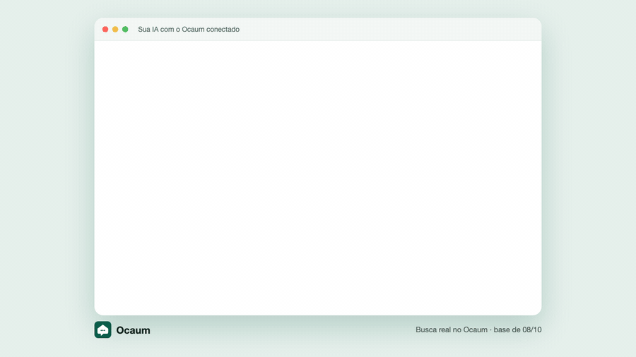

<p align="center"></p>

<h1 align="center">Ocaum</h1>

<p align="center"><b>Seu próximo imóvel, numa conversa.</b><br>A busca de imóveis dos portais, dentro da sua IA.</p>

<p align="center">
  
  
  
</p>

> [!TIP]
> **Uma única busca consulta quatro portais de imóveis ao mesmo tempo.**
>
> - ZAP Imóveis
> - Viva Real
> - OLX
> - QuintoAndar

<p align="center">
  
  <br>
  <sub>Descreva a casa ou o apartamento que você procura, com detalhes como número de quartos, varanda e vaga, e indique se prefere ficar perto do metrô.</sub>
</p>

O Ocaum usa o [Model Context Protocol (MCP)](https://modelcontextprotocol.io) para levar a busca de imóveis ao seu assistente de IA. Veja a apresentação e os exemplos no [site do Ocaum](https://ocaum.com/).

## Por que o Ocaum

Os portais te dão filtros. Você tem perguntas: "2 quartos perto do metrô, com vaga, que aceite pet, e não esteja caro". O Ocaum deixa a sua IA responder isso direto, em linguagem natural, com dados de ZAP Imóveis, Viva Real, OLX e QuintoAndar.

## Sem × com o Ocaum

| ❌ Sem | ✅ Com |
|---|---|
| Abrir ZAP, VivaReal, OLX e QuintoAndar um por um | Uma pergunta busca nos 4 de uma vez |
| Anúncio que já saiu do ar, descoberto só ao clicar | O Ocaum abre cada link antes de responder e descarta o que sumiu |
| "Esse preço está bom?" sem referência | 🟢 abaixo · 🟡 dentro · 🔴 acima do mercado, comparado a imóveis parecidos do bairro |
| Mesmo imóvel repetido em vários portais | Resultado único, com o link de cada anúncio |

## Conectar (2 minutos)

O Ocaum usa um servidor MCP remoto via HTTP com autenticação OAuth.

**URL do servidor** — `https://mcp.ocaum.com/mcp`

Quando o Ocaum abrir a tela de login, informe seu e-mail e digite o código de seis dígitos que chegar na sua caixa de entrada.

| Assistente | Integração | Configuração |
|---|---|---|
| ChatGPT | Disponível | [Passo a passo](#chatgpt) |
| Claude | Disponível | [Passo a passo](#claude) |
| Cursor | Disponível | [Passo a passo](#cursor) |
| Codex | Disponível | [Passo a passo](#codex) |
| Claude Code | Disponível | [Passo a passo](#claude-code) |
| Muse | Em breve | Guia em breve |
| Grok | Em breve | Guia em breve |

Os passos abaixo mostram como adicionar o servidor manualmente em clientes com suporte a MCP remoto e OAuth.

### ChatGPT

1. No ChatGPT pelo navegador, abra **Plugins**.
2. Clique em **+** e escolha **Adicionar servidor MCP personalizado**.
3. Use **Ocaum** como nome, cole a URL do servidor e selecione **OAuth**.
4. Crie o plugin, instale-o e conclua o login quando solicitado.
5. Em uma conversa, digite `@` e selecione o Ocaum antes de enviar a pergunta.

[Documentação do ChatGPT](https://developers.openai.com/api/docs/guides/custom-mcp-server)

### Claude

1. Abra **Personalizar → Conectores**.
2. Clique em **+ Adicionar** e escolha a opção de conector personalizado.
3. Informe **Ocaum** como nome, cole a URL do servidor e revise a autenticação detectada.
4. Adicione o conector e conclua o login.
5. Em uma conversa, abra **+ → Conectores** e ative o Ocaum.

[Documentação do Claude](https://support.claude.com/en/articles/11175166-get-started-with-custom-connectors-using-remote-mcp)

### Cursor

1. Abra `~/.cursor/mcp.json` para configurar o Ocaum em todos os projetos ou `.cursor/mcp.json` na pasta do projeto para configurá-lo apenas ali.
2. Adicione a entrada `ocaum` em `mcpServers`. Preserve as outras entradas se o arquivo já existir.

   ```json
   {
     "mcpServers": {
       "ocaum": {
         "url": "https://mcp.ocaum.com/mcp"
       }
     }
   }
   ```

3. Salve o arquivo, abra a lista de servidores MCP no Cursor e conclua o login quando solicitado.
4. Abra uma conversa com o Agent e peça para usar o Ocaum.

[Documentação do Cursor](https://prod.cursor.com/help/customization/mcp)

### Codex

1. No terminal, adicione o servidor remoto.

   ```sh
   codex mcp add ocaum --url https://mcp.ocaum.com/mcp
   ```

2. Conclua o login no navegador. Se precisar iniciar o login manualmente, execute `codex mcp login ocaum`.
3. Abra uma sessão do Codex e peça para usar o Ocaum.

### Claude Code

1. No terminal, adicione o servidor remoto.

   ```sh
   claude mcp add --transport http ocaum https://mcp.ocaum.com/mcp
   ```

2. Abra o Claude Code, execute `/mcp` e selecione **Authenticate** para o Ocaum.
3. Conclua o login e peça para usar o Ocaum.

## Teste rápido

Cole no chat:

> 2 quartos à venda em Pinheiros até 1 milhão, com elevador

O assistente chama `ocaum_search_properties` e responde com os anúncios e o link de cada um. Se funcionou, está pronto.

## Exemplos de perguntas

- “Busque apartamentos com piscina e academia em Moema, até R$ 1,5 milhão.”
- “Mostre imóveis de 3 quartos na Vila Mariana, perto do metrô.”
- “Procure apartamentos com varanda que aceitem pets no Brooklin.”
- “Compare imóveis de pelo menos 80 m² com duas vagas e condomínio até R$ 900 na Saúde.”
- "Esse anúncio está caro? https://…" (cole o link do ZAP, VivaReal, OLX ou QuintoAndar)
- "Quais bairros têm 'Pinheros'?" (acerta a grafia)
- "Quando foi a última atualização da base?"

## Ferramentas

| Ferramenta | O que faz |
|---|---|
| `ocaum_search_properties` | Busca venda nos 4 portais (ZAP, VivaReal, OLX e QuintoAndar): preço, quartos, vagas, área, condomínio, pet, mobiliado, comodidades e preferências em texto ("perto do metrô"). Ordena por relevância, preço ou R$/m². |
| `ocaum_evaluate_listing` | Recebe o link de um anúncio e diz se está caro (🟢🟡🔴), com os 5 parecidos do bairro. |
| `ocaum_list_neighborhoods` | Acerta a grafia de bairro. |
| `ocaum_index_status` | Quantos anúncios ativos há por portal e há quantas horas foram atualizados. |

## Cobertura

As buscas são de imóveis à venda.

| Região | Disponibilidade |
|---|---|
| Cidade de São Paulo | Disponível |
| Estado de São Paulo | Em breve |
| Acre | Em breve |
| Alagoas | Em breve |
| Amapá | Em breve |
| Amazonas | Em breve |
| Bahia | Em breve |
| Ceará | Em breve |
| Distrito Federal | Em breve |
| Espírito Santo | Em breve |
| Goiás | Em breve |
| Maranhão | Em breve |
| Mato Grosso | Em breve |
| Mato Grosso do Sul | Em breve |
| Minas Gerais | Em breve |
| Pará | Em breve |
| Paraíba | Em breve |
| Paraná | Em breve |
| Pernambuco | Em breve |
| Piauí | Em breve |
| Rio de Janeiro | Em breve |
| Rio Grande do Norte | Em breve |
| Rio Grande do Sul | Em breve |
| Rondônia | Em breve |
| Roraima | Em breve |
| Santa Catarina | Em breve |
| Sergipe | Em breve |
| Tocantins | Em breve |

### Limites de uso

- **Base atualizada todo dia, à meia-noite.** O `ocaum_index_status` mostra a idade de cada portal.
- **Dado que o portal não informa não aparece.** Ausente não quer dizer "não tem".
- **O selo 🟢🟡🔴 é uma aproximação**, não um laudo de avaliação.
- **Limite de uso:** 40 chamadas por minuto e 400 por hora, por pessoa.
- **Servidor ocupado:** a resposta diz em quantos segundos tentar de novo.

## Problemas comuns

- **Não chegou o código:** olhe o spam e as promoções, depois peça outro. O e-mail sai de `access@workos-mail.com`.
- **Erro 401 depois do login:** remova o conector e adicione de novo.
- **O assistente não usa a ferramenta:** peça "use o Ocaum para buscar…".

## Privacidade

O Ocaum registra as buscas. Saiba como esses dados são tratados na [Política de Privacidade](https://ocaum.com/privacidade/).

## Responsáveis

**Tiago Oliveira** ([@tostechbr](https://github.com/tostechbr) · [LinkedIn](https://www.linkedin.com/in/tiagolivesan/)), engenheiro de AI/ML

**Bruno Oliveira** ([@brudevel](https://github.com/brudevel) · [LinkedIn](https://www.linkedin.com/in/brunoliveirasantos/)), Produto, AI

Quer testar, dar feedback ou conversar sobre o projeto? Abra uma [issue](../../issues).

## Mais

[Changelog](CHANGELOG.md) · [Como contribuir](CONTRIBUTING.md) · [Segurança e privacidade](SECURITY.md)
